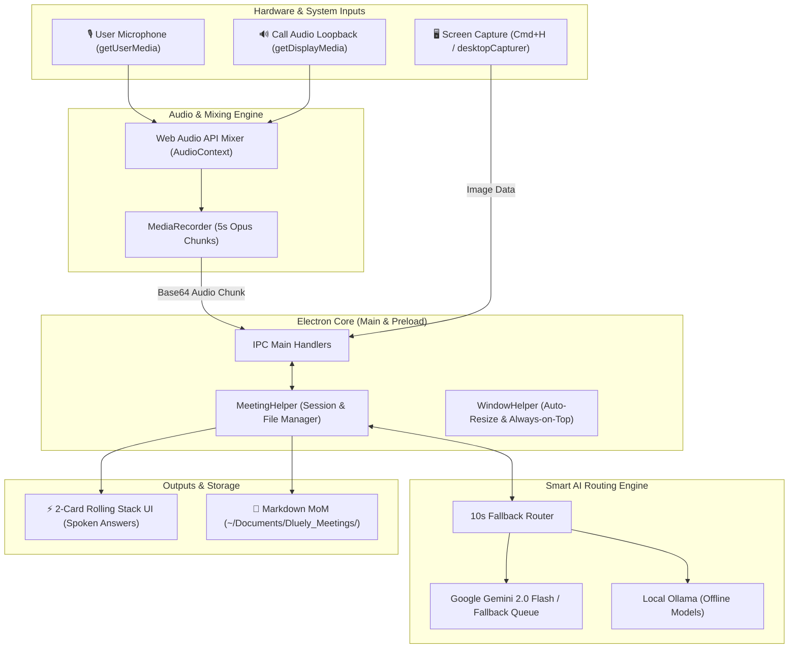
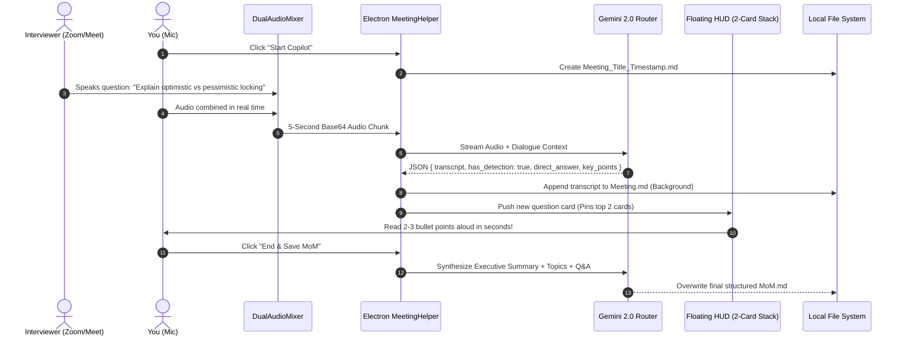

<div align="center">

# 🔮 Dluely
### The Free, Open-Source, Ultra-Fast Real-Time AI Interview Copilot & Desktop Assistant

[](https://opensource.org/licenses/Apache-2.0)
[](https://www.electronjs.org/)
[](https://react.dev/)
[](https://www.typescriptlang.org/)
[](https://vitejs.dev/)
[](https://aistudio.google.com/)
[](https://ollama.ai)

<p align="center">
  <strong>Invisible desktop overlay that listens to meetings & live calls, catches questions, gives spontaneous direct spoken answers in seconds, transcribes background Minutes of Meeting (MoM), and instantly solves coding/technical problems from screen captures.</strong>
</p>

<p align="center">
  
</p>

</div>

---

## 📖 What is Dluely?

**Dluely** (formerly *FreeCluely*) is a 100% free, community-driven, open-source reconstruction and evolution of the viral desktop app "Cluely" created by Roy Lee.

While commercial interview tools lock essential features behind costly monthly subscriptions ($29–$99/month), rely on closed-source telemetry, and restrict you to proprietary cloud models, **Dluely delivers superior performance with complete transparency, dual-audio call capture, local offline AI options, and automated document synthesis.**

### How Dluely Improves Upon the Original Cluely

| Capability | Cluely (Proprietary / Closed) | Dluely (Open Source & Free) |
| :--- | :--- | :--- |
| **Pricing & License** | $29 – $99 / month (Proprietary) | **100% Free Forever (Apache-2.0 License)** |
| **Dual Audio Capture** | Microphone only or complex virtual cables | **Simultaneous Mic + Call Loopback (Zoom/Teams/Meet)** |
| **Screen Noise vs. Answers** | Dumps raw continuous transcript wall | **Smart Filter: Zero transcript clutter; shows ONLY detected questions & concepts** |
| **Spoken Answer Format** | Long, conversational AI essays | **Direct Spoken Answers: 2–3 high-impact bullet points ready to speak in seconds** |
| **Card Retention** | Disappears or floods screen | **2-Card Rolling Stack: Active + preceding question pinned; older cards archived to MoM** |
| **Meeting Minutes (MoM)** | Manual export or none | **Automated background MoM markdown saved to `~/Documents/Dluely_Meetings/`** |
| **AI Fallback & Latency** | Single-model point of failure (429/503 errors) | **10s Smart Fallback Router across Gemini 2.0/1.5 models with winning-model persistence** |
| **Privacy & Offline** | Mandatory cloud telemetry | **100% Local Offline Mode via Ollama (Llama 3.2, DeepSeek-R1, Mistral)** |
| **Problem Solving** | Often describes images ("In this screenshot...") | **Strict "Solve, Do Not Describe" prompt engineering with instant optimal code** |

---

## 🌟 Key Features

### 🎙️ Live Interview Copilot (Dual-Audio & 2-Card Stack)
- **Simultaneous Dual-Channel Audio**: Captures your microphone **plus** the interviewer's call audio (Zoom, Google Meet, Teams, Discord) using the Web Audio API without needing external cables.
- **Noise-Free Smart Question Detector**: Suppresses continuous transcript walls. Pops up high-contrast cards **only** when an interview question or technical term is detected.
- **Direct Spoken Answers**: Generates 2–3 punchy, natural talking points formulated specifically to be read aloud to the interviewer within seconds.
- **2-Card Rolling Visual Stack**: Keeps the active question and immediately preceding question pinned on screen so you never lose context during follow-ups.
- **Automatic MoM Synthesis**: Continuously records dialogue in the background and synthesizes a full Minutes of Meeting (MoM) Markdown document in `~/Documents/Dluely_Meetings/`.

### ⚡ Instant Screen Solver (`Cmd + H` / `Ctrl + H`)
- **"Solve, Do Not Describe" Directive**: Never wastes time explaining what the image looks like. Instantly extracts the algorithmic, mathematical, or multiple-choice problem and outputs:
  - Optimal code solution (Python, C++, Java, TypeScript, Go).
  - Time & Space complexity ($O(N)$, $O(1)$).
  - 2-sentence key intuition.
- **Multi-Screenshot Queue**: Queue up to 5 screenshots across problem descriptions, constraints, and test cases before solving.

### 🛡️ 10-Second Gemini Fallback Router
- Prevents interview-ending loading freezes.
- Automatically cascades through:
  `gemini-2.0-flash` ➔ `gemini-2.0-flash-lite` ➔ `gemini-1.5-flash` ➔ `gemini-1.5-flash-8b` ➔ `gemini-1.5-pro`.
- If a model takes longer than 10 seconds, hits quota limits (429), or throws a 503 error, Dluely switches instantaneously.
- **Winning-Model Memory**: The fastest working model is retained for subsequent questions.

### 🏠 100% Local AI Support via Ollama
- Run completely offline without internet or API keys.
- Supports any Ollama model: `llama3.2`, `codellama`, `deepseek-r1`, `mistral`, `qwen2.5-coder`.
- Zero data leaves your machine.

---

## 📐 Architecture & Workflow

### 1. High-Level System Architecture



### 2. Live Interview Audio & MoM Flow



---

## 🛠️ Tech Stack

### Frontend & UI
- **React 18** – Modern functional components, custom hooks, and state management.
- **TypeScript 5** – Strict end-to-end type safety across renderer, preload, and electron processes.
- **Tailwind CSS** – Custom liquid-glass UI styling with high-contrast readable typography.
- **React Query** – Smooth caching and real-time query invalidation.
- **React Icons & Lucide** – Minimal iconography.
- **Vite 5** – Sub-second HMR and optimized asset bundling.

### Desktop & Native Layer
- **Electron 33** – Cross-platform desktop runtime (`transparent: true`, `alwaysOnTop: true`).
- **Web Audio API (`AudioContext`)** – Dual-channel stream mixing into `MediaStreamAudioDestinationNode`.
- **MediaRecorder API** – Low-overhead Opus audio chunking at 5000ms intervals.
- **Desktop Capturer** – High-resolution native screen capture with display loopback audio support.

### AI & LLM Engine
- **`@google/generative-ai`** – Native Google Gemini SDK with direct multimodal audio and image support.
- **Ollama REST API** – Offline local LLM inference via `http://localhost:11434`.
- **Custom Resilience Layer** – Dynamic timeout wrapping, 429 quota backoff, and winning-model retention.

---

## 🚀 Quickstart Guide

### Prerequisites
1. **Node.js**: `v18.0.0` or higher ([Download Node.js](https://nodejs.org/)).
2. **API Key (Free)**: A free Google Gemini API key from [Google AI Studio](https://aistudio.google.com/).  
   *(Or install [Ollama](https://ollama.ai) for offline mode).*

### 1. Clone & Install

```bash
# Clone the repository
git clone https://github.com/your-username/dluely.git

# Navigate into the project folder
cd dluely

# Install dependencies cleanly
npm install
```

### 2. Configure Environment

Copy the example environment template:

```bash
cp .env.example .env
```

Open `.env` in your editor and insert your Gemini API key:

```env
# Google Gemini API Key (Get free at https://aistudio.google.com/)
GEMINI_API_KEY=your_gemini_api_key_here

# (Optional) Set to true if you want to use local Ollama offline
USE_OLLAMA=false
OLLAMA_URL=http://localhost:11434
```

> **Note:** `.env` is included in `.gitignore` and is never committed.

### 3. Run in Development Mode

```bash
npm start
```
*This command starts Vite on port `5180`, launches the Electron desktop shell, and attaches global shortcuts.*

### 4. Build for Production

```bash
# Builds both renderer and electron bundles
npm run build

# Packages into standalone desktop executable (.dmg / .exe / .AppImage)
npm run dist
```
Compiled production packages are created in the `release/` folder.

---

## ⌨️ Keyboard Shortcuts Reference

| Shortcut | Action | Description |
| :--- | :--- | :--- |
| **`Cmd/Ctrl + B`** | **Show / Hide Window** | Instantly toggles the liquid-glass HUD on or off. |
| **`Cmd/Ctrl + H`** | **Take Screenshot** | Captures problem area and queues it for instant solving. |
| **`Cmd/Ctrl + Enter`** | **Solve Problem** | Solves all queued screenshots using the "Solve, Do Not Describe" engine. |
| **`Cmd/Ctrl + R`** | **Reset Queues** | Clears all screenshots and resets views. |
| **`Cmd/Ctrl + Shift + Space`** | **Center Window** | Restores and centers the window on your primary display. |
| **`Cmd/Ctrl + Arrow Keys`** | **Nudge Window** | Moves the floating window across your screen. |
| **`Cmd/Ctrl + Q`** | **Quit Application** | Completely exits the application. |

---

## 📁 Repository Structure

```
dluely/
├── assets/                  # App icons, DMG build resources & entitlements
├── electron/                # Electron Main & Preload Process
│   ├── LLMHelper.ts         # Multimodal AI caller, 10s fallback router & prompts
│   ├── MeetingHelper.ts     # Session manager, audio processor & MoM file writer
│   ├── ProcessingHelper.ts  # Screenshot & audio job dispatcher
│   ├── ScreenshotHelper.ts  # Native display capturer & queue manager
│   ├── WindowHelper.ts      # Transparent bounds, auto-resizing & positioning
│   ├── ipcHandlers.ts       # IPC bridge between Renderer and Main process
│   ├── main.ts              # Electron lifecycle, tray, desktop audio handlers
│   ├── preload.ts           # Secure contextBridge exposure
│   ├── shortcuts.ts         # Global keyboard hotkey listeners
│   └── tsconfig.json        # TypeScript configuration for Electron
├── src/                     # React 18 Renderer Process
│   ├── _pages/              # Main view containers (Queue, Solutions)
│   ├── components/
│   │   ├── Meeting/         # InterviewCopilot.tsx (2-Card Stack & Live Controls)
│   │   ├── Queue/           # QueueCommands.tsx, ScreenshotQueue.tsx
│   │   ├── Solutions/       # SolutionView.tsx, Code blocks, Syntax highlighter
│   │   └── ui/              # ModelSelector.tsx, Toast, Dialogs
│   ├── lib/
│   │   └── audioMixer.ts    # DualAudioMixer (Web Audio API mic + call combiner)
│   ├── types/
│   │   └── electron.d.ts    # TypeScript definitions for window.electronAPI
│   ├── App.tsx              # Root React component
│   └── main.tsx             # React DOM entry
├── .env.example             # Safe environment template
├── index.html               # Vite HTML entry
├── package.json             # Scripts & dependency definitions
├── tailwind.config.js       # Tailwind CSS design system
├── tsconfig.json            # TypeScript configuration for React
└── vite.config.ts           # Vite build configuration
```

---

## 🔒 Privacy & Local Storage

- **Zero Telemetry**: Dluely does not track keystrokes, sessions, analytics, or user identifiers.
- **Local Minutes of Meeting**: All generated interview transcripts and MoM markdown files are saved strictly on your local disk at:
  ```
  ~/Documents/Dluely_Meetings/
  ```
- **Local AI Privacy**: When `USE_OLLAMA=true` is enabled, 100% of reasoning occurs locally on your machine with zero outbound network calls.
- **Temporary Cache Cleanup**: Captured screenshot files are automatically purged after processing.

---

## 🤝 Contributing

Contributions are welcome! Feel free to:
1. Fork the repository.
2. Create your feature branch (`git checkout -b feature/amazing-feature`).
3. Commit your changes (`git commit -m 'Add amazing feature'`).
4. Push to the branch (`git push origin feature/amazing-feature`).
5. Open a Pull Request.

---

## 📄 License

This project is open-source software licensed under the **[Apache License 2.0](LICENSE)**. Free for personal, educational, and commercial use.
